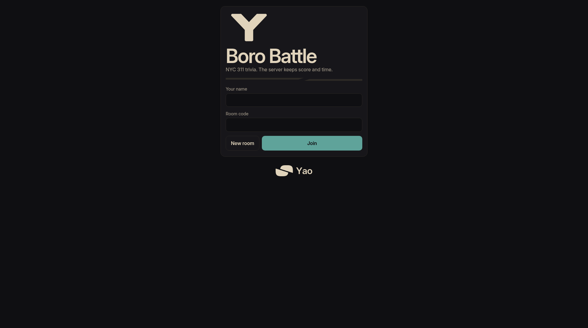
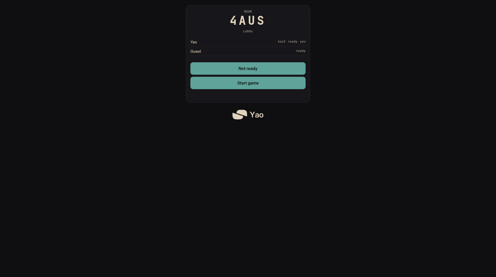
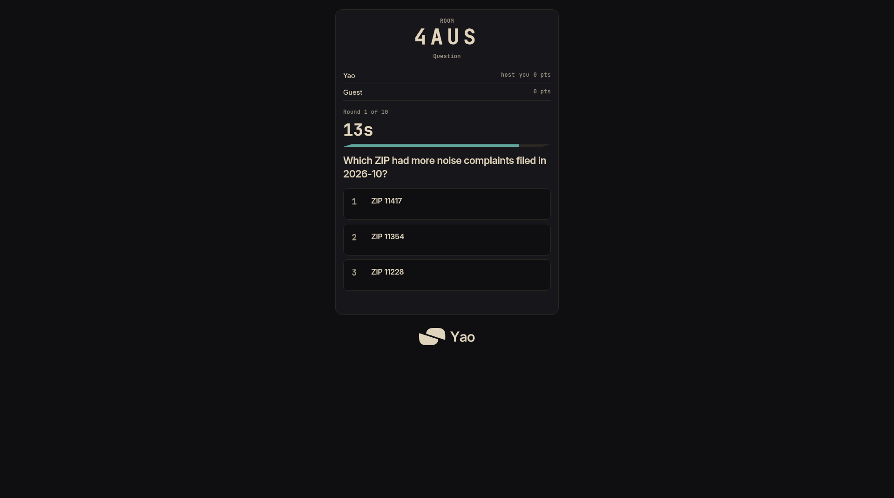
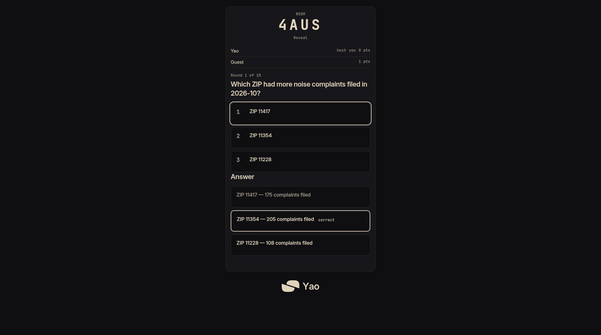
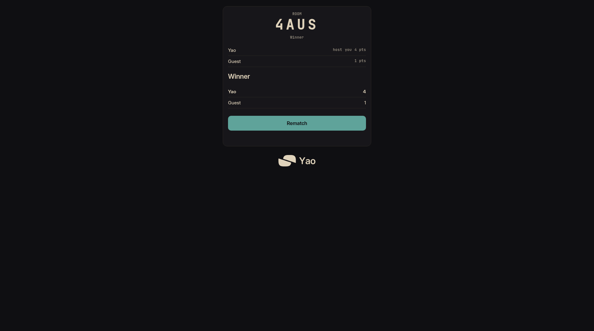
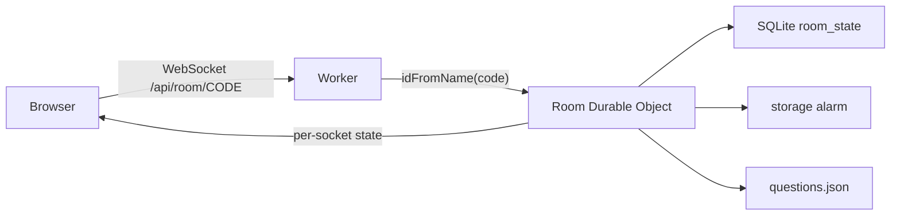

# Boro Battle

**Play:** https://boro-battle.yaoban.dev

A New York trivia game for 2 to 8 players in the browser. Each of the 10 rounds asks which neighborhood had more noise complaints, or which neighborhood had more rodent complaints, in one month of NYC 311 data. The server keeps the 15-second timer and the score.

- One player creates a room. The others join with its four-letter code.
- The questions are built ahead of time from the [NYC 311 Service Requests](https://data.cityofnewyork.us/Social-Services/311-Service-Requests-from-2010-to-Present/erm2-nwe9) dataset, so a game makes no live data calls.
- The browser sends only its choice. The answers and counts arrive after the round ends, and late answers score zero.
- Built with one Cloudflare Worker, one Durable Object per room (state in SQLite), WebSockets, and plain HTML, CSS and TypeScript.

## Screenshots







## Development

```bash
npm install
npm run build:questions   # fetches 311 data; needs network
npm test                  # scoring and phase rules
npm run typecheck
npm run dev               # builds the client and runs wrangler dev
```

Stack: one Cloudflare Worker, one SQLite-backed Durable Object per room (`idFromName` on the room code), hibernating WebSockets, plain HTML/CSS/TypeScript.

The browser bundle (`public/client.js`) is generated by `npm run build:client`, which `npm run dev` runs for you. To publish your own copy, log in with `npx wrangler login` and run `npx wrangler deploy`.

## Testing

`npm test` and `npm run typecheck` are the project checks. The tests assert that:

- the answer key and complaint counts stay hidden until reveal
- a correct answer after the deadline scores 0
- disconnect and rejoin keeps the score
- an oversized, malformed, or unknown client message is ignored

## Architecture



## Design notes

- **Durable Object state:** players, deck, phase, and answers persist in SQLite inside `Room`, so hibernation does not wipe the game.
- **WebSocket flow:** a client message hits `webSocketMessage`, updates state, persists, then `broadcast` sends each socket a personalized `state` payload.
- **Trust boundary:** the client is untrusted input. Only the worker applies deadlines and increments scores.

## License

[MIT](LICENSE). Built by Yao.
